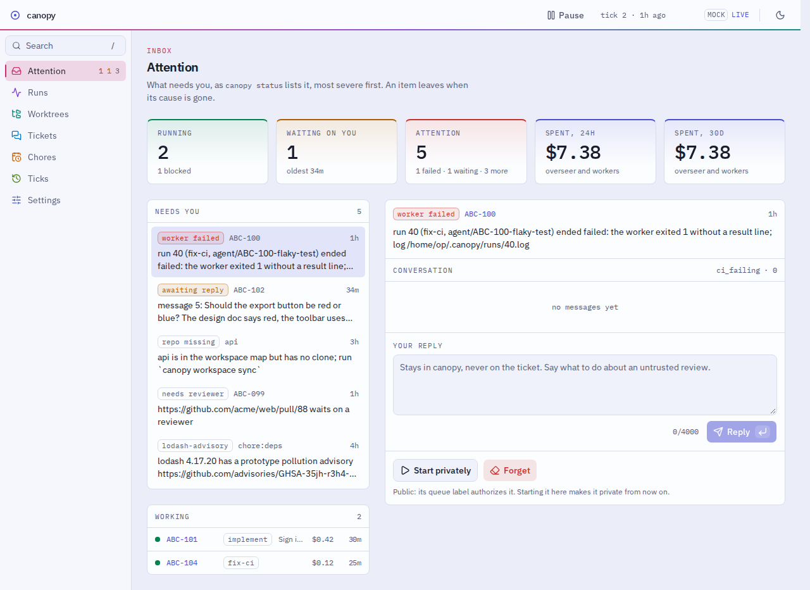

# canopy

> Not on PyPI: `canopy` there is an unrelated project. canopy installs from this repository or its releases (D046).

An unattended, local agent loop driven by your issue tracker.

Label a ticket. When there is capacity, an overseer agent leases a worktree from
a [treehouse](https://github.com/kunchenguid/treehouse) pool, dispatches a worker
agent to do the work, pushes a branch, opens a PR, and releases the worktree.
CI failures and review comments are picked up on later ticks. A running
attention list tells you what actually needs a human.

Everything runs on your machine, under your credentials. No hosted service holds
standing write access to your repositories, your tracker, or your internal tools.



**Status:** pre-alpha, in use by its operator since the first live session (2026-10-12). The loop, the web UI, chores,
notifications, and private tickets are built; sandboxed workers (M26) and cutting the overseer's spend (M28 to M30)
are not yet. Milestones: [docs/ROADMAP.md](docs/ROADMAP.md); live checks still to run:
[docs/SCENARIOS.md](docs/SCENARIOS.md); what it must do, and how far along each requirement is:
[docs/REQUIREMENTS.md](docs/REQUIREMENTS.md).

## Why this exists

- Hosted "label a ticket, get a PR" agents cannot reach systems behind your own
  auth, and require granting a vendor write access to your code and tracker.
  canopy runs where your credentials already are.
- Juggling checkouts is the real daily cost of running several agents at once.
  treehouse already solves that; canopy builds on it instead of reinventing it.
- Orchestration is a prompt, not a workflow engine. The overseer decides what to
  do each tick from live state, so ticket dependencies and branch stacking need
  no DSL and no schema change.

## Install (target: five steps, no more)

1. Install [treehouse](https://github.com/kunchenguid/treehouse) from source at the commit canopy needs:
   `CGO_ENABLED=0 go install github.com/kunchenguid/treehouse@1185dc6cc50e1b66ef5c74b8ac677a6251258abc` (in a canopy
   checkout, `make treehouse` does the same). No release has the lease output canopy reads yet, and `treehouse update`
   installs a release binary that needs glibc 2.34+.
2. Install canopy. Either:
   - From a release, with no credential, Python, or uv on the machine that runs canopy (D067). Where you are signed in
     to GitHub, download `canopy-<platform>` from the
     [latest release](https://github.com/eddieland/canopy/releases/latest) (or `gh release download --repo
     eddieland/canopy --pattern 'canopy-linux-x86_64*'`), check it against its `.sha256`, and copy it to the machine
     as `~/.local/bin/canopy` (`mkdir -p ~/.local/bin` first if it is missing, and put it on `PATH` if it is not).
     Make it executable and add the sinks beside it, as scripts that run it with `SCIE_BOOT` set to their name (a
     link to it can run canopy itself instead):

     ```sh
     cd ~/.local/bin && chmod +x canopy
     for sink in canopy-notify-desktop canopy-notify-slack; do
         rm -f "$sink" && printf '#!/bin/sh\nexec env SCIE_BOOT=%s "%s/canopy" "$@"\n' "$sink" "$PWD" >"$sink"
         chmod +x "$sink"
     done
     ```

     On macOS, a browser download needs `xattr -d com.apple.quarantine canopy` too. To upgrade, replace the file.
   - Or from git: `uv tool install git+https://github.com/eddieland/canopy`. The repository is private; git needs an
     HTTPS credential for it, as for any private clone. Not `uv tool install canopy`: that name on PyPI is another
     project. To upgrade, run the same command with `--reinstall`.
3. In your agent runtime (OpenCode), connect the GitHub MCP server and your tracker's MCP server (Jira, Linear, anything
   with one; for GitHub Issues the GitHub server is both). Your runtime holds the tokens; canopy never sees them.
   Workers need write tools to comment on a ticket, edit its labels, and open PRs; the reviewer needs only read tools.
   Grant nothing more: canopy's definitions deny the dangerous ones by name, but names differ by server. On GitHub
   the only tool that sets labels, `issue_write`, also creates and closes issues; without it, PRs go unlabeled (D084).
4. In an empty directory, which becomes your workspace: `canopy init --provider jira https://github.com/acme/api.git`
   (or `github`, or your tracker's name). This writes your personal config (`$XDG_CONFIG_HOME/canopy/config.toml`, by
   default `~/.config/canopy/config.toml`, with a queue label of your own), writes the workspace's
   `canopy-workspace.toml`, and clones the repository under `repos/`. canopy writes nothing into your repositories and
   installs nothing else: agent runs load its agent definitions and skills from its own directory (D016, D040). Set
   `tracker.query` in `canopy-workspace.toml`. Use HTTPS clone URLs with a credential helper; worker sandboxing is not
   expected to support SSH.
5. Add your label (`agent-ready-<you>` by default) to a ticket, then run `canopy loop --dry-run --ticks 1` in the
   workspace and read the plan. Once you trust it, leave `canopy loop` running: it ticks, waits `loop.interval_minutes`
   (15 by default), longer while nothing changes, and repeats until you press Ctrl-C. It also serves the web UI at
   `http://127.0.0.1:8765/`; `canopy secret` prints the listener secret its sign-in page asks for.

## Daily surface

Leave `canopy loop` running (tmux works) and work from the web UI it serves at `http://127.0.0.1:8765/`: the attention
list, runs, worktrees, every ticket's conversation, canopy's reviews with their findings on the diff, and your chores,
with a search box (`/`) over the whole journal.
Label tickets with your queue label, answer the agents' questions on the ticket, and review their PRs. Humans approve
and merge; the agent never does. Only reviewers in `trust.trusted_reviewers` send a worker back to a PR on their own;
anyone else's comments wait on the attention list as `untrusted_review` until you reply.

| To | Run |
| --- | --- |
| Tick now, or pause and resume the loop | `t` or `p` in its terminal; `canopy pause`, `canopy resume` |
| Read your config again after editing it | `kill -HUP` the loop (its header prints the pid), or Reload in the web UI's settings |
| Read the attention list | `canopy status`, or `.canopy/attention.md` |
| Read a ticket's conversation, or answer canopy there | `canopy show KEY`, `canopy reply KEY 'text'` |
| Work a ticket privately, with no label and nothing written to it | `canopy start KEY`, then `canopy stop KEY` |
| Start a ticket over, once its PR is closed and its branch deleted | `canopy forget KEY` |
| Allow one more run past an `attempt_limit` | `canopy grant KEY implement` (or `resume`, `fix-ci`) |
| See what a tick decided and what it cost | `canopy decisions [TICK] [--ticket KEY]` |
| Read a run's transcript | its page in the web UI, or `opencode export <session id>` |
| Teach your own agent session canopy | save `canopy skill` as `~/.agents/skills/canopy/SKILL.md` |

Optional, in your user config: notification sinks for attention changes (`canopy-notify-desktop`,
`canopy-notify-slack`; DESIGN §20), a reviewer agent on PRs (`[review]`; §21), and chores, recurring checks that report
to the attention list (§19; see `examples/chores/README.md`). The details are in
[docs/design/LOOP.md](docs/design/LOOP.md) and [docs/design/CONVERSATIONS.md](docs/design/CONVERSATIONS.md).

## Growing your setup

The install steps set up a workspace of one repository. [docs/GETTING_STARTED.md](docs/GETTING_STARTED.md) goes on from
there, one stage at a time: slots that need local files or an install, a pool of a set size made ahead of time, several
repositories sharing one queue, and a large Bazel repository with a pool of warm slots.

## Troubleshooting

- If canopy cannot find `treehouse`, check that it is on `PATH` (usually by adding `$(go env GOPATH)/bin`). If it is
  outdated, rerun the pinned install from step 1 above or run `make treehouse` in a canopy checkout.
- If the overseer records `skip` with `mcp_unavailable: github`, configure the GitHub MCP server in your agent runtime.
- For more detail, check `canopy decisions`, `canopy status`, and the effective log path reported by canopy's command
  output.

## How it works, briefly

```text
canopy loop
  take the loop lock
  until Ctrl-C:
    canopy tick (below)
    print what it did, then wait loop.interval_minutes, doubling after each idle tick up to loop.idle_max_minutes

canopy tick
  acquire lock, run migrations
  reconcile: dead workers, stale leases
  run the overseer agent:
    read the world (tracker and GitHub via MCP, treehouse pool)
    derive each ticket's phase
    decide a next action per ticket
    dispatch workers up to capacity
    update the attention list
  exit
```

canopy has no tracker code. Agents reach the tracker through its MCP server, guided by a short provider-neutral contract
and, where it helps, a provider skill (Jira and GitHub Issues ship). See [DESIGN §17](docs/design/WORKSPACES.md#17-trackers).

State lives in a SQLite journal. Facts about the world (ticket status, PRs,
CI, reviews) are always re-read from their source of truth, never from the DB.
Details in [docs/design/](docs/design/README.md). Security posture in
[docs/TRUST_MODEL.md](docs/TRUST_MODEL.md).

## Related work

- **treehouse**: worktree pool with durable leases. Required dependency.
- **firstmate** (same author as treehouse): an interactive tmux captain/crew
  orchestrator. Different shape: canopy is unattended and queue-driven.
- **GitHub Copilot coding agent, Atlassian Rovo Dev**: hosted equivalents. See
  "Why this exists".
- **OpenAI Symphony, agent-orchestrator, Hermes Agent Kanban**: open-source loops that dispatch agents from a
  tracker or board. Why canopy is built anyway, and what their issue trackers taught: D050 and
  [docs/PRIOR_ART.md](docs/PRIOR_ART.md).

## License

MIT (D046). See [LICENSE](LICENSE). It is not supported: issues and pull requests from outside may go unanswered.
