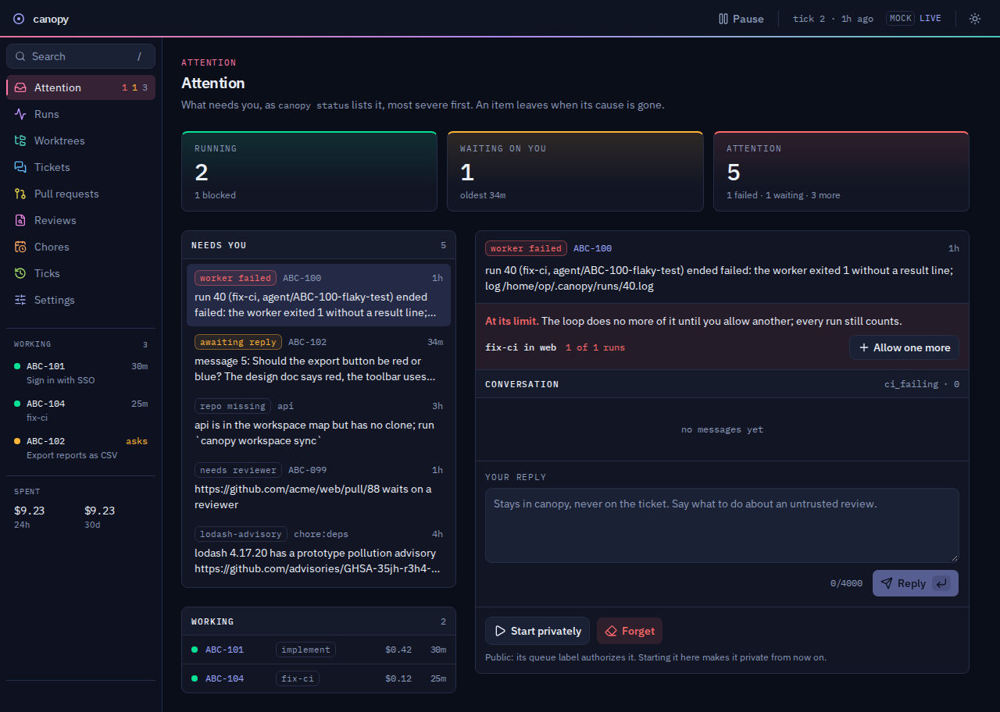
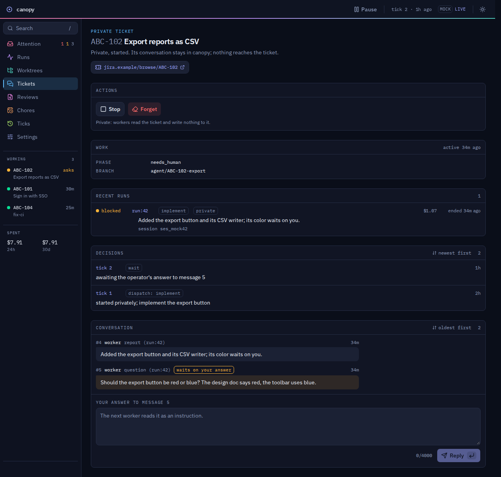
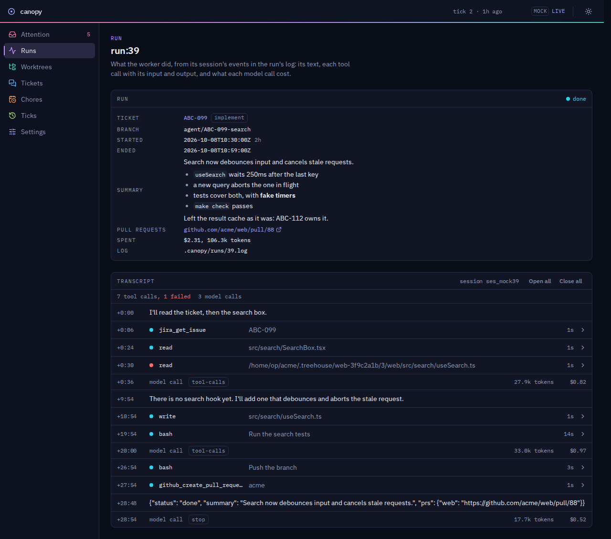
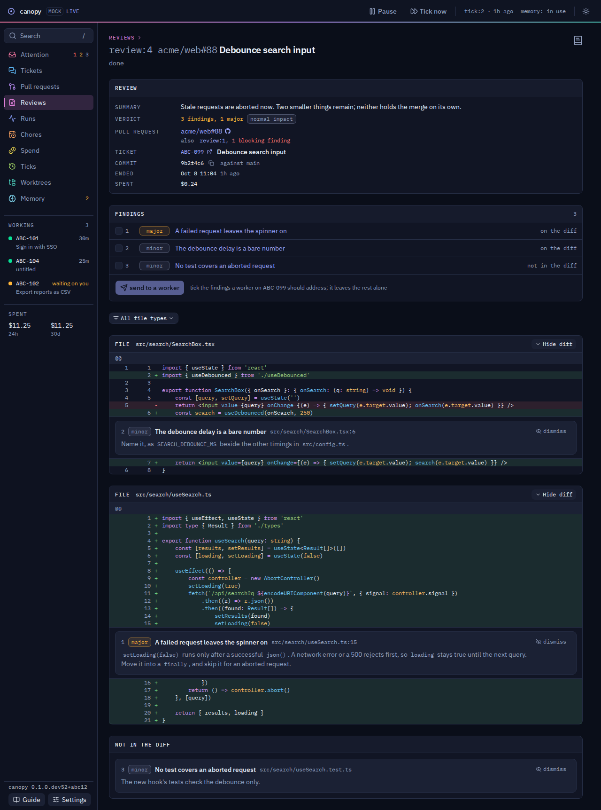
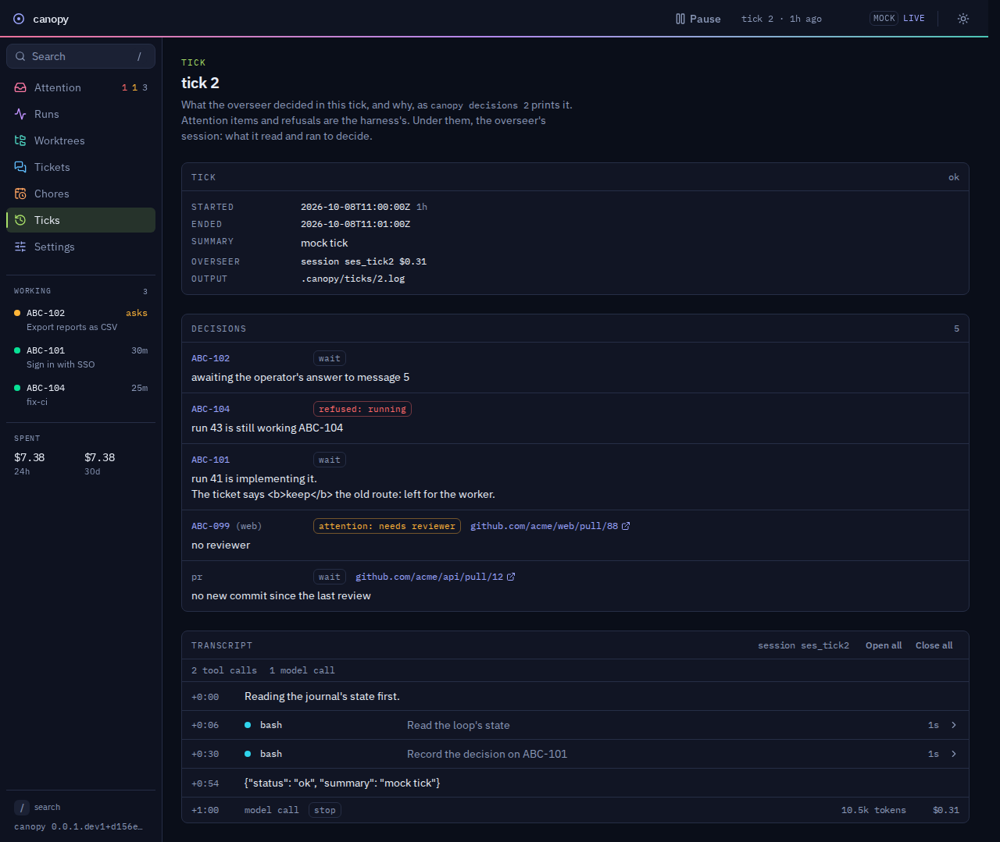

# canopy

[](https://codecov.io/gh/eddieland/canopy)

An unattended, local agent loop driven by your issue tracker.

Label a ticket. When there is capacity, an overseer agent leases a worktree from a
[treehouse](https://github.com/kunchenguid/treehouse) pool and dispatches a worker agent, which does the work, pushes a
branch, and opens a PR; then the worktree goes back to the pool. Later ticks pick up CI failures and review comments. A
running attention list tells you what actually needs a human.

Everything runs on your machine, under your credentials. No hosted service holds standing write access to your
repositories, your tracker, or your internal tools.

> Not on PyPI: `canopy` there is an unrelated project. Install canopy from this repository.



**Status:** pre-alpha, in use by its operator since the first live session (2026-10-12). The loop, the web UI, chores,
notifications, and private tickets are built. Sandboxed workers (M26) and cutting the overseer's spend further (M36
to M39) are not yet.

- Milestones: [docs/ROADMAP.md](docs/ROADMAP.md)
- Live checks still to run: [docs/SCENARIOS.md](docs/SCENARIOS.md)
- What canopy must do, and how far along each requirement is: [docs/REQUIREMENTS.md](docs/REQUIREMENTS.md)

Codes such as D046 name entries in [docs/DECISIONS.md](docs/DECISIONS.md), and § numbers name sections of the design in
[docs/design/](docs/design/README.md).

## Why this exists

- Hosted "label a ticket, get a PR" agents cannot reach systems behind your own auth, and they require granting a
  vendor write access to your code and tracker. canopy runs where your credentials already are.
- Juggling checkouts is the real daily cost of running several agents at once. treehouse already solves that; canopy
  builds on it instead of reinventing it.
- Orchestration is a prompt, not a workflow engine. The overseer decides what to do each tick from live state, so
  ticket dependencies and branch stacking need no DSL and no schema change.

## How it works, briefly

```text
canopy loop
  take the loop lock
  until Ctrl-C:
    canopy tick (below)
    print what it did, then wait loop.interval_minutes, doubling after each idle tick up to loop.idle_max_minutes

canopy tick
  acquire lock, run migrations
  reconcile: dead workers, stale leases
  run the overseer agent:
    read the world (tracker and GitHub via MCP, treehouse pool)
    derive each ticket's phase
    decide a next action per ticket
    dispatch workers up to capacity
    update the attention list
  exit
```

canopy has no tracker code. Agents reach the tracker through its MCP server, guided by a short provider-neutral contract
and, where it helps, a provider skill (Jira and GitHub Issues ship). See [DESIGN §17](docs/design/WORKSPACES.md#17-trackers).

State lives in a SQLite journal. Facts about the world (ticket status, PRs, CI, reviews) are always re-read from their
source of truth, never from the journal. The details are in [docs/design/](docs/design/README.md), and the security
posture in [docs/TRUST_MODEL.md](docs/TRUST_MODEL.md).

## Install (target: five steps, no more)

Or let your own coding agent (Claude Code, OpenCode, ...) walk you through them in an interview, from making the
workspace to a first dry tick, with the sandbox if you want it: [docs/QUICKSTART.md](docs/QUICKSTART.md).

1. **Install treehouse** from source, at the commit canopy needs:

   ```sh
   CGO_ENABLED=0 go install github.com/kunchenguid/treehouse@1185dc6cc50e1b66ef5c74b8ac677a6251258abc
   ```

   In a canopy checkout, `make treehouse` does the same. Do not use a release or `treehouse update`: no release has the
   lease output canopy reads yet, and the release binary needs glibc 2.34+.

2. **Install canopy** from git, with [uv](https://docs.astral.sh/uv/). It needs Node 22.12+ and npm on `PATH` (with
   nvm: `nvm install 22`), because the install builds the web UI:

   ```sh
   uv tool install git+https://github.com/eddieland/canopy
   ```

   Not `uv tool install canopy`: that name on PyPI is another project (D046). To upgrade, run the same command with
   `--reinstall`.

3. **Connect your MCP servers.** In your agent runtime (OpenCode), connect the GitHub MCP server and your tracker's MCP
   server (Jira, Linear, anything with one; for GitHub Issues the GitHub server is both). Your runtime holds the
   tokens; canopy never sees them.

   Grant only what the agents need. Workers need write tools to comment on a ticket, edit its labels, and open PRs;
   the reviewer needs only read tools. canopy's agent definitions deny the dangerous tools by name, but names differ by
   server. On GitHub, the only tool that sets labels, `issue_write`, also creates and closes issues; without it, PRs go
   unlabeled (D084).

4. **Create a workspace.** In an empty directory, which becomes your workspace, run:

   ```sh
   canopy init --provider jira https://github.com/acme/api.git
   ```

   Use `github`, or your tracker's name, in place of `jira`. Use an HTTPS clone URL with a credential helper: worker
   sandboxing is not expected to support SSH. `canopy init`:

   - writes the workspace's private config, yours alone, with a queue label of your own, to `.canopy/config.toml`;
   - writes the workspace's `canopy-workspace.toml`;
   - clones the repository under `repos/`.

   Then set `tracker.query` in `canopy-workspace.toml`. Point it only at a tracker where everyone who can file a
   ticket is someone you trust, never at a public repository's issues: a ticket is the task, so its author steers your
   agents, with your credentials. canopy writes nothing into your repositories and installs nothing else: agent runs
   load its agent definitions and skills from its own directory (D016, D040).

5. **Run it.** Add your label (`agent-ready-<you>` by default) to a ticket, then run
   `canopy loop --dry-run --ticks 1` in the workspace and read the plan.

   Once you trust it, leave `canopy loop` running. It ticks, waits `loop.interval_minutes` (15 by default, longer while
   nothing changes), and repeats until you press Ctrl-C. `canopy daemon start` runs it in the background instead, until
   `canopy daemon stop`. It also serves the web UI at `http://127.0.0.1:8765/`;
   `canopy secret` prints the listener secret its sign-in page asks for.

## Daily surface

Leave `canopy loop` running (tmux works, or `canopy daemon start`) and work from the web UI it serves at
`http://127.0.0.1:8765/`. It shows the attention list, runs, worktrees, every ticket's conversation, canopy's reviews
with their findings on the diff, and your chores, with a search box (`/`) over the whole journal. Its guide, opened
from the foot of the rail, says what each page holds and how to act on it. To look at it without a loop, run
`uv run python -m canopy.serve --mock --port 8766` in a checkout, after `make ui-build`: it serves the same pages over
the sample journal in `src/canopy/serve/mock.py`, with no sign-in and `mock` shown in the header.

Your part is to label tickets with your queue label, answer the agents' questions on the ticket, and review their PRs.
Humans approve and merge; the agent never does. Only reviewers in `trust.trusted_reviewers` send a worker back to a PR
on their own; anyone else's comments wait on the attention list as `untrusted_review` until you reply.

| A ticket's conversation, waiting on your answer | A run's transcript: each tool call, and what it cost |
| --- | --- |
|  |  |
| **canopy's review of a PR, its findings on the diff** | **What the overseer decided in a tick, and why** |
|  |  |

| To | Run |
| --- | --- |
| Tick now, or pause and resume the loop | `t` or `p` in its terminal, or the web UI's header; `canopy pause`, `canopy resume` |
| Tell every run about a CI outage until it is over | `canopy notice 'TEXT' --for 4h`, or the web UI's settings |
| Read your config again after editing it | Reload in the web UI's settings, or `kill -HUP` the loop |
| Read the attention list | `canopy status`, or `.canopy/attention.md` |
| Read a ticket's conversation, or answer canopy there | `canopy show KEY`, `canopy reply KEY 'text'` |
| Work a ticket privately, with no label and nothing written to it | `canopy start KEY`, then `canopy stop KEY` |
| Work every labeled ticket privately | `private = true` under `[tracker]` in `.canopy/config.toml` |
| Start a ticket over, once its PR is closed and its branch deleted | `canopy forget KEY` |
| Allow one more run past an `attempt_limit` | `canopy grant KEY implement` (or `resume`), or the ticket's page |
| Allow one more review past a `review_limit` | `canopy grant PR_URL review`, or the PR's page |
| Have canopy review a coworker's PR | `canopy start PR_URL --review`, or the reviews page |
| See what a tick decided and what it cost | `canopy decisions [TICK] [--ticket KEY]` |
| See what the last days cost, how much of it idle ticks spent, and what each ticket done cost | `canopy spend [--days N]`, or the web UI's spend page |
| See which ticks and runs failed lately, and what the guards refused | `canopy health [--days N]` |
| See what canopy keeps of its own history, and what your retention would remove | `canopy gc --dry-run` |
| Read a run's transcript | its page in the web UI, or `opencode export <session id>` |
| Teach your own agent session canopy | `canopy skill --install`, which saves it in `~/.agents/skills/canopy/` |
| Complete canopy's commands, repositories, and chores with Tab | `canopy completion bash` (or `zsh`, `fish`); its help says how to load it |

Optional, in the workspace's `.canopy/config.toml`, or in `~/.config/canopy/config.toml` for every workspace:

- notification sinks for attention changes, `canopy-notify-desktop` and `canopy-notify-slack` (§20);
- a reviewer agent on PRs, `[review]` (§21);
- chores: recurring checks that report to the attention list (§19; see
  [examples/chores/README.md](examples/chores/README.md)).

The details are in [docs/design/LOOP.md](docs/design/LOOP.md) and
[docs/design/CONVERSATIONS.md](docs/design/CONVERSATIONS.md).

## Growing your setup

The install steps set up a workspace of one repository. [docs/GETTING_STARTED.md](docs/GETTING_STARTED.md) goes on from
there, one stage at a time:

- slots that need local files or an install;
- a pool of a set size, made ahead of time;
- several repositories sharing one queue;
- a large Bazel repository with a pool of warm slots.

To run workers in a sandbox, so a steered worker cannot read your secrets or change canopy's config, run
`canopy sandbox setup` and follow [docs/SANDBOX.md](docs/SANDBOX.md). It is opt-in, and not yet proven.

## Troubleshooting

- **canopy cannot find `treehouse`:** check that it is on `PATH` (usually by adding `$(go env GOPATH)/bin`). If it is
  outdated, rerun the pinned install from step 1, or `make treehouse` in a canopy checkout.
- **The overseer records `skip` with `mcp_unavailable: github`:** configure the GitHub MCP server in your agent runtime.
- **Anything else:** check `canopy decisions`, `canopy status`, and the log, `.canopy/canopy.log` in the workspace.

## Related work

- **treehouse**: worktree pool with durable leases. Required dependency.
- **firstmate** (same author as treehouse): an interactive tmux captain/crew orchestrator. Different shape: canopy is
  unattended and queue-driven.
- **GitHub Copilot coding agent, Atlassian Rovo Dev**: hosted equivalents. See [Why this exists](#why-this-exists).
- **OpenAI Symphony, agent-orchestrator, Hermes Agent Kanban**: open-source loops that dispatch agents from a tracker or
  board. Why canopy is built anyway, and what their issue trackers taught: D050 and
  [docs/PRIOR_ART.md](docs/PRIOR_ART.md).

## License

MIT (D046). See [LICENSE](LICENSE). canopy is not supported: issues and pull requests from outside may go unanswered.
