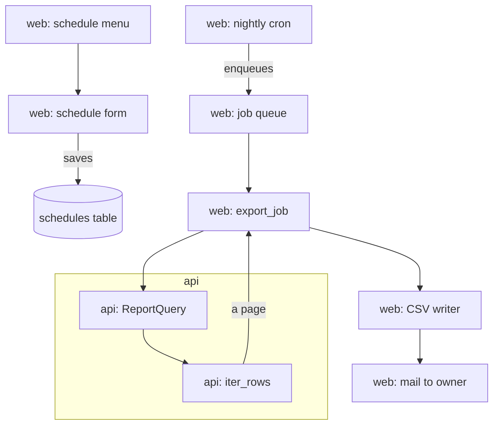
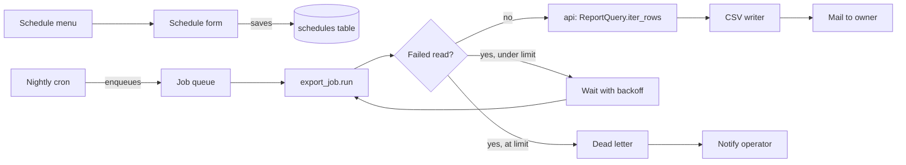
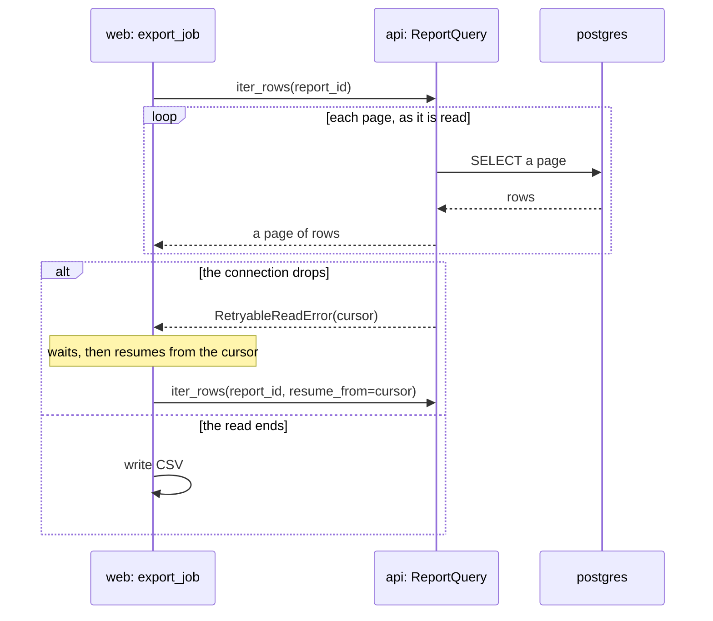
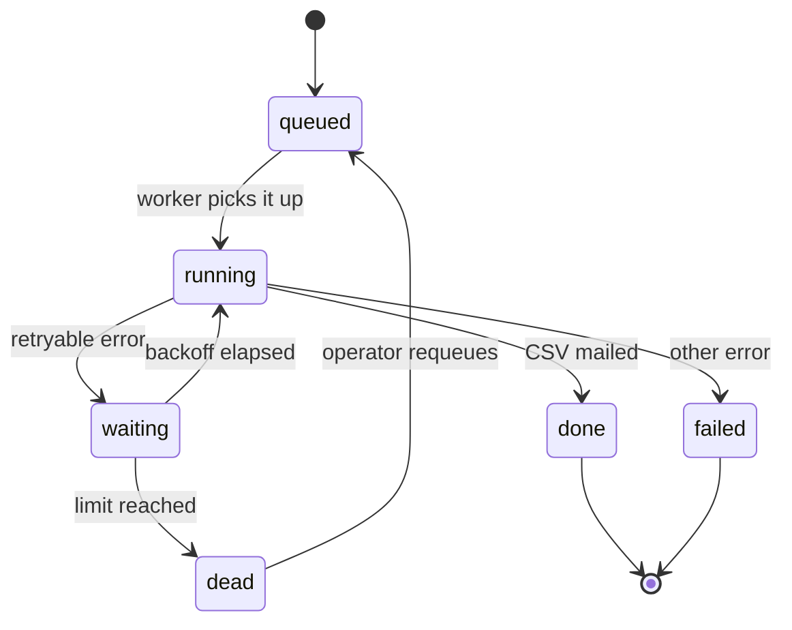
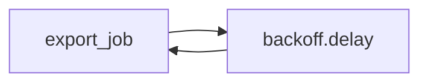
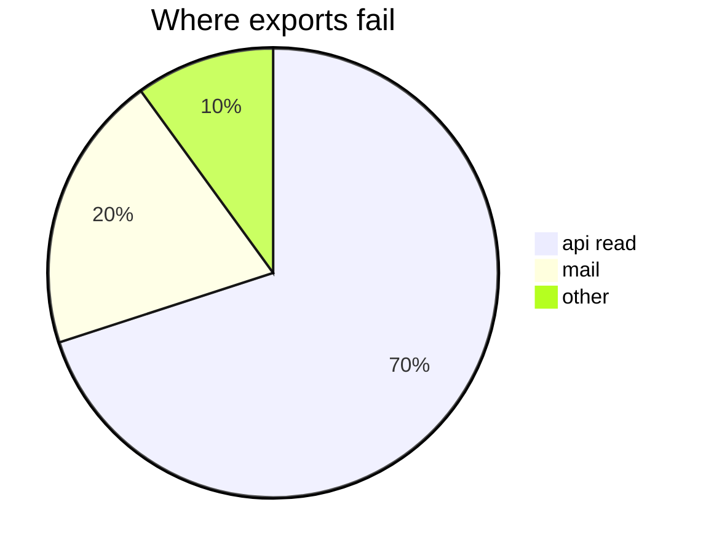

# Retry exports that fail mid-read

## Context

A scheduled export runs as a job in **web**, which reads the report's rows from **api** a page at a time. When the
connection drops, the job fails whole and the owner gets nothing.



The same path, as the job reads it, left to right:



## Step 1: api and web: resume a read



| Repository | File | Change | Signature | Test | Acceptance |
| --- | --- | --- | --- | --- | --- |
| api | `api/reports/query/iterators/paged_rows.py` | raise `RetryableReadError` when the connection drops mid-page, keeping the cursor so the caller resumes from the page that failed rather than the first | `iter_rows(report_id: int, *, resume_from: Cursor \| None = None) -> Iterator[Row]` | `test_paged_rows.py` | a dropped page resumes |
| web | `app/jobs/export_job.py` | catch it and wait | `run(schedule_id: int) -> ExportResult` | `test_export_job.py` | a job retries |
| web | `app/jobs/backoff.py` | new | `delay(attempt: int, base_s: float) -> float` | `test_backoff.py` | the waits double |

## Step 2: web: a status for the wait





| Attempt | Delay (s) | Cumulative (s) | Share of budget |
| ---: | ---: | ---: | ---: |
| 1 | 30 | 30 | 3% |
| 2 | 60 | 90 | 10% |
| 3 | 120 | 210 | 23% |
| 4 | 240 | 450 | 50% |

| Key | Default |
| --- | --- |
| `retry.limit` | `4` |
| `retry.base_s` | `30` |

```python
def delay(attempt: int, base_s: float) -> float:
    """The wait before `attempt`, doubling each time."""
    return base_s * 2 ** (attempt - 1)
```

## Tests

- [x] `delay` doubles
- [ ] the job stops at `retry.limit`
- [ ] a dead export notifies the operator

> A migration adds the `waiting` status. Roll back by deleting rows in it first.

---

## Risks



```mermaid
flowchart TD
    A[web --> B[api
    B -->
```
